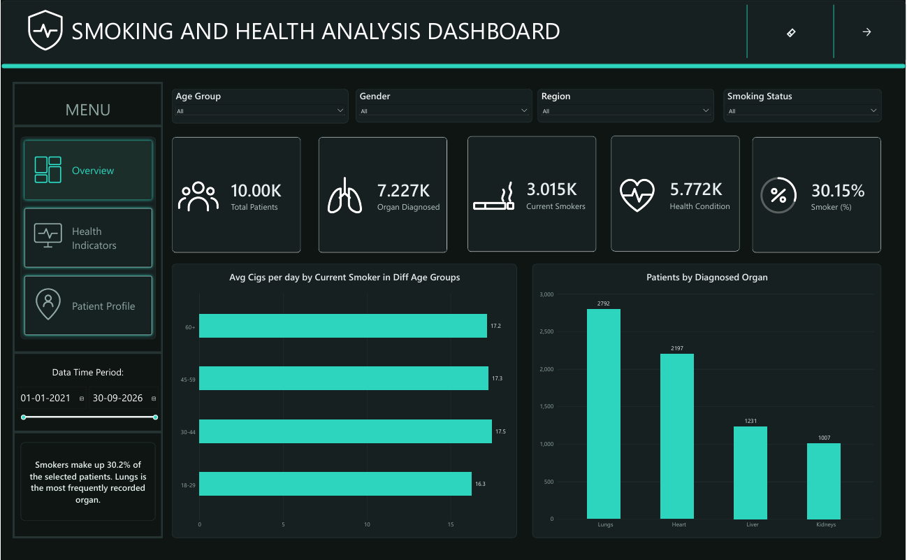
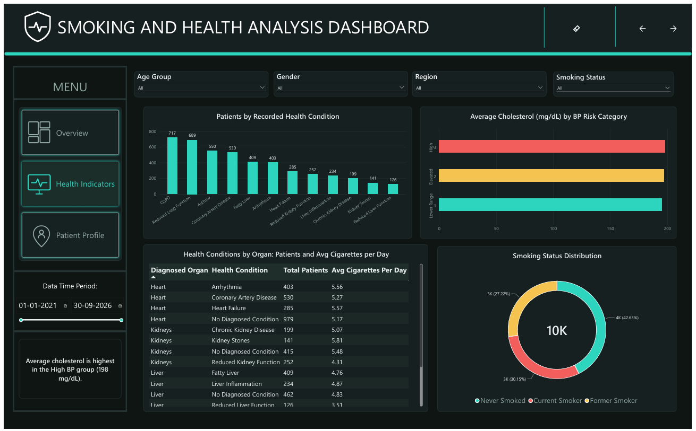
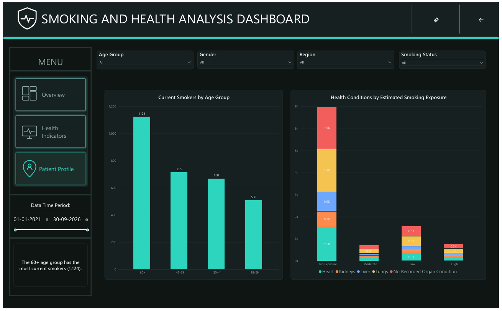

# Smoking and Health Analysis Dashboard

An interactive Power BI dashboard built on 10,000 patient records. It brings smoking habits, recorded organ diagnoses, health conditions, blood pressure and cholesterol into one report, and asks a simple question: **how do patients' smoking habits line up with their recorded health, and where do the patterns hold or fail to hold?**

Built as an internship project. The report is exploratory and educational. It does not diagnose anyone and it does not show that smoking causes any condition.



---

## Project overview

A health analyst reporting to management needs a fast, honest view of the patient base: how many patients there are, how many smoke, which organs and conditions are recorded, and whether blood pressure and cholesterol vary across groups. This project takes a patient-level file, adds the calculated columns and measures the analysis needs, and publishes a three-page dashboard with shared slicers, a date filter and a small insight box that rewrites itself as filters change.

A deliberate part of the project is honesty about the data. Several results are flat across age groups, genders, regions and smoking status, and one field (cigarettes per day) is only recorded for current smokers. The dashboard and this README say so instead of forcing a story.

## Repository structure

```
smoking-and-health-analysis/
├── README.md
├── dashboard/
│   ├── smoking & health analysis.pbix     Power BI report
│   └── smoking & health analysis.pdf      Static export of all three pages
├── data/
│   └── Smoking_Health_Analysis.csv        Patient-level dataset (10,000 rows)
└── images/
    ├── overview.png
    ├── health_indicators.png
    └── patient_profile.png
```

## Business questions

1. How many patients are there, how many currently smoke, and how many have a recorded organ diagnosis or health condition?
2. How much do patients smoke, and does that change with age?
3. Which organs and conditions are recorded most often, and how are they split?
4. Is smoking status linked to the share of patients with a recorded condition?
5. Does average cholesterol differ across blood pressure risk categories?
6. Where are current smokers concentrated by age group, and do conditions change with estimated smoking exposure?

## Dataset

| Item | Detail |
|---|---|
| File | `data/Smoking_Health_Analysis.csv` |
| Size | 10,000 patients, 15 columns, one row per patient |
| Period | Diagnosis dates from 1 January 2021 to 30 September 2026 |
| Age range | 18 to 85 |
| Data quality | No missing values, every `Patient_ID` is unique |

| Group | Columns |
|---|---|
| Identity and time | Patient_ID, Diagnosis_Date |
| Demographics | Age, Gender (Male, Female, Other), Region (North, South, East, West, Central) |
| Smoking | Smoking_Status (Never Smoked, Former Smoker, Current Smoker), Cigarettes_Per_Day, Years_Smoking |
| Diagnosis | Diagnosed_Organ (Lungs, Heart, Liver, Kidneys, No Recorded Organ Condition), Health_Condition (15 conditions plus No Diagnosed Condition) |
| Clinical readings | Total_Cholesterol_mg_dL, Systolic_BP_mmHg, Diastolic_BP_mmHg, BMI, Resting_Heart_Rate_bpm |

## Data model and DAX

Everything sits on one table, `Smoking_Health_Analysis`, with a separate `measure` table that holds the DAX measures.

**Calculated columns**

| Column | Logic |
|---|---|
| Age Group | 18-29, 30-44, 45-59, 60+ (the youngest patient is 18, so no under-18 group is needed) |
| BP Risk Category | High if systolic is 140 or more or diastolic is 90 or more. Elevated if systolic is 120 or more or diastolic is 80 or more. Otherwise Lower Range. |
| Smoking Exposure Level | Estimated pack-years = (cigarettes per day / 20) x years smoked. Low is under 10, Moderate is 10 to under 20, High is 20 or more. |
| Age Group Sort, BP Risk Sort, Exposure Sort | Helper columns so categories appear in a logical order instead of alphabetically |

**Measures**

| Measure | Definition |
|---|---|
| Total Patients | Count of patients (10,000) |
| Current Smokers | Patients whose status is Current Smoker (3,015) |
| Smoker % | Current smokers divided by total patients (30.15%) |
| Patients with Organ diagnose | Patients with a recorded organ, meaning anything other than No Recorded Organ Condition (7,227) |
| Patients with Health Condition | Patients whose condition is anything other than No Diagnosed Condition (5,772) |
| Avg Cigs per Current Smoker | Average cigarettes per day among current smokers only |
| Top Organ, Insight Text, Insight Text P2, Insight Text P3 | Dynamic text for the insight box, recalculated with every filter |

## Dashboard pages

Three pages share one navigation panel (page buttons, date slicer and insight box) and four slicers: Age Group, Gender, Region and Smoking Status.

| Page | What it shows |
|---|---|
| Overview | Five KPI cards, average cigarettes per day by age group (current smokers), patients by diagnosed organ |
| Health Indicators | Patients by recorded health condition, average cholesterol by BP risk category, organ and condition table with average cigarettes per day, smoking status distribution |
| Patient Profile | Current smokers by age group, health conditions by estimated smoking exposure level |





## Key findings snapshot

All figures are calculated from the full dataset. P-values come from simple tests run on the CSV, are unadjusted for multiple comparisons, and are given for context only.

| Area | Finding |
|---|---|
| Patients | 10,000 patients aged 18 to 85. 3,015 are current smokers (30.15%), 2,722 former (27.22%) and 4,263 never smoked (42.63%). |
| Organs | 7,227 patients (72.3%) have a recorded organ. Lungs lead with 2,792, then Heart 2,197, Liver 1,231 and Kidneys 1,007. 2,773 patients have no recorded organ. |
| Conditions | 5,772 patients (57.7%) have a recorded health condition. The most common are COPD (717), Reduced Lung Function (689), Asthma (550) and Coronary Artery Disease (530). |
| Consumption | Cigarettes per day is only recorded for current smokers. They average 17.1 a day, and the figure barely moves by age (16.3 for 18-29 up to 17.5 for 30-44, p = 0.25). Averaging all patients would dilute it to 5.2. |
| Age | 60+ has the most current smokers (1,124) because it is the largest group (3,734 patients). The share of current smokers is similar in every age group, from 28.6% to 31.4% (p = 0.31). |
| Gender and region | Smoker share is 30.2% for men and 30.3% for women. By region it runs from 29.1% (South) to 32.2% (Central). Neither difference is significant (p = 0.21 and 0.31). |
| Smoking and conditions | A recorded condition is present for 57.4% of current smokers, 56.9% of former smokers and 58.4% of never smokers (p = 0.45). The organ mix is also nearly identical across the three groups. |
| Exposure | Among current smokers, the share with a recorded condition is 59.0% at Low exposure, 57.8% at Moderate and 53.9% at High (p = 0.07). There is no rising pattern. |
| BP and cholesterol | 5,053 patients are Elevated, 2,500 Lower Range and 2,447 High. Average cholesterol is 195.4, 197.2 and 197.9 mg/dL. The gap of about 2.5 mg/dL is statistically detectable (p = 0.017) but small. |

## Recommendations snapshot

| Recommendation | Strength of support |
|---|---|
| Do not target smoking interventions by age group, gender or region based on this data, because the smoker share is about 30% almost everywhere | Data-backed |
| Review how non-organ conditions are classified: Hypertension, High Cholesterol and Type 2 Diabetes (1,237 patients) all sit under "No Recorded Organ Condition" | Data-backed |
| Record cigarettes per day for former smokers, so their past exposure can be estimated and compared | Data gap |
| Confirm the data source before using any of this for clinical or policy decisions, because the patterns are unusually flat | Reasoned, not measured |

## Design notes

- Dark theme with a custom Power BI theme (dark green-black canvas, slightly lighter cards).
- Colour carries meaning and stays the same on every page: teal for never smoked and lower risk, ember orange for current smokers, amber for former smokers and elevated readings, red only for high blood pressure risk.
- A left navigation panel holds the page buttons, the date range slicer and an insight box with different text on each page.

## Limitations and biases

- **The data looks simulated.** Smoker share is almost identical across ages, genders and regions, and recorded conditions do not differ by smoking status. Confirm the source before presenting results as facts about real patients.
- **Association, not causation.** The brief for this report is exploratory. Nothing here establishes that smoking causes a condition, and no result is a medical diagnosis.
- **Exposure is estimated for current smokers only.** Former smokers have years smoked but no cigarettes per day, so pack-years cannot be calculated for them. The exposure chart is filtered to current smokers for that reason.
- **Thresholds are simple choices.** The BP bands loosely follow the common 120/80 and 140/90 cut-offs and the exposure bands (10 and 20 pack-years) are my own. The label is "Lower Range", not "Normal".
- **One record per patient.** There is no follow-up over time, so smoking cannot be compared before and after a diagnosis.
- **Small group.** Only 189 patients are recorded as Other gender, so their rates are unstable.
- **Many comparisons.** The p-values quoted above are unadjusted and should be read as rough guides.

## How to open the report

1. Install [Power BI Desktop](https://powerbi.microsoft.com/desktop/) (free, Windows).
2. Download `dashboard/smoking & health analysis.pbix` and open it.
3. If Power BI cannot find the data, go to **Transform data > Data source settings** and point the source to `data/Smoking_Health_Analysis.csv` on your machine.
4. For a quick look without Power BI, open `dashboard/smoking & health analysis.pdf`.

## Tech stack

Microsoft Power BI, DAX, Power Query, CSV

## Author

**Samarth Gupta**
GitHub: [github.com/samarthgupta95](https://github.com/samarthgupta95)
